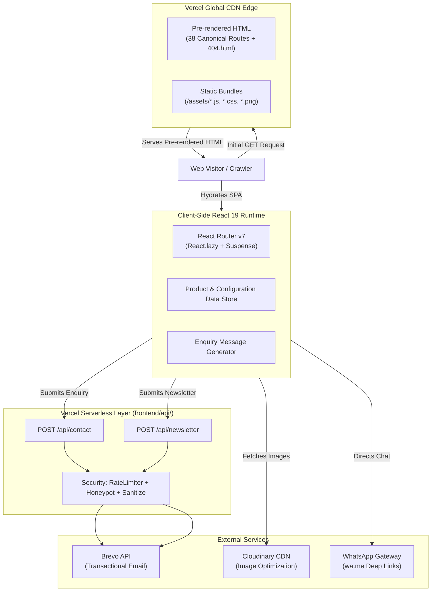
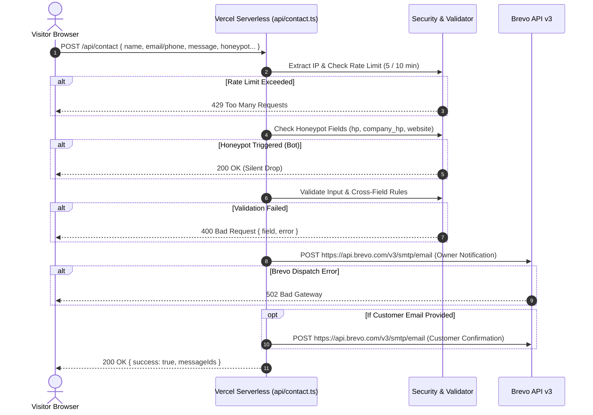

# SURFURIA — Project Documentation & Engineering Handbook

**Engineering Handbook — Version 1.0 — 2026-10-31**  
**Live Production Website:** [https://www.surfuria.com](https://www.surfuria.com)

---

## Table of Contents

1. [Business Domain & Product Overview](#chapter-1-business-domain--product-overview)
2. [Technology Choices & Rationale](#chapter-2-technology-choices--rationale)
3. [Architecture & System Design](#chapter-3-architecture--system-design)
4. [Repository & Folder Structure](#chapter-4-repository--folder-structure)
5. [Routing & Code Splitting](#chapter-5-routing--code-splitting)
6. [Hardware Catalogue — Data Model & Navigation](#chapter-6-hardware-catalogue--data-model--navigation)
7. [Kitchen Architecture — Configurations & Suites](#chapter-7-kitchen-architecture--configurations--suites)
8. [SEO Architecture](#chapter-8-seo-architecture)
9. [Design System & Styling](#chapter-9-design-system--styling)
10. [Animation Architecture](#chapter-10-animation-architecture)
11. [Contact API — Complete Implementation Guide](#chapter-11-contact-api--complete-implementation-guide)
12. [Newsletter API — Complete Implementation Guide](#chapter-12-newsletter-api--complete-implementation-guide)
13. [Enquiry System & Message Generation](#chapter-13-enquiry-system--message-generation)
14. [Email Template Architecture](#chapter-14-email-template-architecture)
15. [WhatsApp Integration](#chapter-15-whatsapp-integration)
16. [Social Media Configuration](#chapter-16-social-media-configuration)
17. [Performance Architecture](#chapter-17-performance-architecture)
18. [Security Architecture](#chapter-18-security-architecture)
19. [Development History & Engineering Phases](#chapter-19-development-history--engineering-phases)
20. [External Service Dependencies](#chapter-20-external-service-dependencies)
21. [Local Development Guide](#chapter-21-local-development-guide)
22. [Testing Strategy & Test Suite](#chapter-22-testing-strategy--test-suite)
23. [Deployment & Production Configuration](#chapter-23-deployment--production-configuration)
24. [Project Metrics](#chapter-24-project-metrics)
25. [Known Limitations & Technical Debt](#chapter-25-known-limitations--technical-debt)
26. [Interview Preparation — Questions & Answers](#chapter-26-interview-preparation--questions--answers)
27. [Glossary](#chapter-27-glossary)

---

## Chapter 1: Business Domain & Product Overview

### 1.1 Brand & Domain
Surfuria is a commercial architectural hardware and modular kitchen design studio. The brand operates in high-end architectural and residential interiors, supplying precision furniture fittings (hydraulic hinges, tandem drawer slides, architectural handles, and cabinetry accessories) and factory-engineered modular kitchen layouts.

### 1.2 Target Market
- **Domestic (India):** Primary consumer and contractor base across metropolitan regions seeking engineered modular systems and precision hardware.
- **Export & Trade (Global Reach):** Contract manufacturing, bulk architectural supply, and international export partners across North America, Europe, and the Middle East (highlighted via interactive Three.js 3D globe visualization on the About page).

### 1.3 Business Model: Enquiry-Driven Commerce
Unlike conventional B2C e-commerce websites with shopping carts and payment gateways (e.g., Stripe/Razorpay), Surfuria operates on an **enquiry-driven lead generation model**:
1. High-ticket architectural hardware and custom kitchen layouts require project-specific dimensions, site inspections, and finishes customization.
2. The digital platform serves as an interactive technical showroom and specification engine.
3. Every call-to-action (CTA) directs visitors into a context-aware enquiry workflow:
   - Dedicated contact form pre-filled with technical specifications of the viewed product or layout.
   - Deep-linked WhatsApp conversations with pre-drafted enquiries specifying product lines or turnkey packages.
4. Final sales conversion occurs through direct consultation between the client and Surfuria's specification studio.

### 1.4 Product Catalogues
1. **Architectural Hardware Catalogue:** 14 flagship products categorized into 6 technical categories (Cabinet Hinges & Lift Systems, Drawer Systems, Door & Cabinet Handles, Pullout Storage Units, Corner Solutions, and Cabinet & Drawer Accessories).
2. **Modular Kitchens Catalogue:**
   - **4 Factory-Engineered Turnkey Packages:** Single Wall (₹89,000), L-Shaped (₹99,000), Island (₹99,000), and U-Shaped (₹1,11,000) with fixed door/box panel square footage, preselected hardware suites, and inclusive transportation and installation.
   - **10 Kitchen Suite Products:** Tailored architectural commissions and conceptual suites spanning Modular, Modern, Island, Storage, and Custom Kitchen categories.

---

## Chapter 2: Technology Choices & Rationale

| Technology | Role | Version | Rationale & Architectural Justification |
|---|---|---|---|
| **React** | Core UI Framework | `19.3.1` | Component-based modularity, concurrent rendering features, and deep ecosystem compatibility for animation and 3D graphics. |
| **Vite** | Build Tool & Bundler | `8.3.4` | Sub-millisecond Hot Module Replacement (HMR) powered by native ES modules; Rollup-based production tree-shaking and custom plugin hooks. |
| **TypeScript** | Static Typing | `~6.0.3` | End-to-end type safety unifying frontend UI components, product catalogues, serverless API request validation, and Brevo email payload structures. |
| **React Router DOM** | Client Routing | `7.18.4` | Declarative client-side routing supporting dynamic nested URL segments (`/hardware/:categorySlug/:productSlug`) and route aliases. |
| **Vercel Serverless Functions** | Backend Execution | Node.js Runtime | Zero-maintenance backend infrastructure co-located with the frontend application; automatic edge routing without maintaining long-running Node/Express servers. |
| **Brevo Transactional API** | Email Dispatch | v3 REST API | Reliable transactional email delivery over HTTPS REST; avoids fragile SMTP port blocking on serverless edge nodes; API key isolated to server environment. |
| **Cloudinary** | Asset Delivery CDN | Cloud CDN | Offloads heavy image payloads from the git repository and Vercel bandwidth limits; provides low-latency worldwide image hosting. |
| **Three.js** | 3D Interactive WebGL | `0.186.1` | Interactive 3D globe on the About page rendering spherical arcs and global distribution pins. Code-split and lazy-loaded to prevent initial load penalties. |
| **GSAP & ScrollTrigger** | Scroll Animation | `3.15.0` | Production-grade scroll pinning, timeline sequencing, and scrub animations in complex hero transitions (`HeroScrollTransition.tsx`). |
| **Motion for React** | UI Micro-Interactions | `14.6.0` | Declarative spring animations, mount/unmount page transitions (`AnimatePresence`), and automated respect for `prefers-reduced-motion`. |
| **Vitest** | Testing Suite | `5.0.5` | Native ESM test runner executing against TypeScript directly; sub-second test execution across all 9 test suites without compilation lag. |
| **Native CSS & Tokens** | Styling Architecture | CSS3 | Zero runtime styling overhead; CSS custom properties (`tokens.css`) manage colors, typography, fluid clamps, and spacing without CSS-in-JS bundle bloat. |
| **Build-Time Pre-Renderer** | Social Crawling & SEO | Custom Plugin | `prerenderPlugin.ts` bakes SEO metadata into individual HTML files per route at build time, solving SPA social crawler indexing without SSR overhead. |

---

## Chapter 3: Architecture & System Design

Surfuria is architected as a hybrid **Client-Side SPA with Build-Time Pre-Rendering and On-Demand Edge Serverless Functions**:



### 3.1 Three Core System Layers
1. **Edge Static Delivery (CDN):** Pre-rendered HTML documents representing 38 canonical routes plus a custom `404.html` are deployed directly to Vercel's global edge network. Static JavaScript and CSS bundles are served with 1-year immutable caching (`max-age=31536000, immutable`).
2. **Client SPA Engine:** Upon initial render, React 19 takes over client-side navigation. All page routes are code-split using `React.lazy()`. Heavy assets (such as Three.js WebGL globe) are completely isolated from entry bundles.
3. **Serverless API Execution (`/api/*`):** Stateless Node.js handlers handle form submissions, IP extraction, rate limiting, anti-spam honeypot detection, input validation, and transactional email dispatches via Brevo.

---

## Chapter 4: Repository & Folder Structure

```
surfuria/
└── frontend/                          # Single application root
    ├── api/                           # Vercel Serverless Function entrypoints
    │   ├── contact.ts                 # POST /api/contact handler
    │   └── newsletter.ts              # POST /api/newsletter handler
    ├── server/                        # Server-only modules (imported by api/)
    │   ├── brevo/
    │   │   ├── brevoClient.ts         # TypeScript definitions for Brevo payloads
    │   │   └── sendTransactionalEmail.ts # Fetch client sending emails to Brevo v3
    │   ├── config/
    │   │   └── serverConfig.ts        # Official contacts, Brevo credentials loader
    │   ├── email/
    │   │   ├── emailTypes.ts          # Email generator return interfaces
    │   │   └── templates/
    │   │       ├── customerConfirmationEmail.ts # Responsive HTML email for client
    │   │       ├── newsletterNotificationEmail.ts # HTML email for newsletter signup
    │   │       └── ownerContactEmail.ts   # Comprehensive HTML email for studio owner
    │   ├── security/
    │   │   ├── honeypot.ts            # Hidden input bot detection
    │   │   ├── ipExtractor.ts         # Edge IP resolution
    │   │   ├── rateLimiter.ts         # In-memory sliding-window IP rate limiter
    │   │   └── sanitize.ts            # HTML entity escaping
    │   └── validation/
    │       ├── contactValidation.ts   # Contact payload validation logic
    │       └── newsletterValidation.ts# Newsletter email validation logic
    ├── src/                           # React frontend application
    │   ├── app/
    │   │   └── router.tsx             # Route declarations with React.lazy
    │   ├── assets/                    # Optimized logos and static media
    │   ├── build/
    │   │   └── prerenderPlugin.ts     # Vite build plugin for route pre-rendering
    │   ├── components/
    │   │   ├── catalog/               # Category pills, product carousels, cards
    │   │   ├── layout/                # Navbar, MegaMenu, Footer, SiteLayout
    │   │   ├── seo/                   # SEOHead and Schema.org JSON-LD builders
    │   │   └── ui/                    # Button, WhatsApp floating trigger
    │   ├── config/
    │   │   ├── social.ts              # Environment-driven social profiles
    │   │   └── whatsapp.ts            # WhatsApp resolver and deep-link builder
    │   ├── data/
    │   │   ├── about/                 # Studio history and philosophy
    │   │   ├── kitchens/              # Kitchen technical specifications
    │   │   ├── navigation/            # Mega menu and drawer navigation links
    │   │   ├── products/              # Hardware and kitchen catalog records
    │   │   └── site/                  # Footer links, brand metadata
    │   ├── lib/
    │   │   ├── enquiryContext.ts      # Query parameter parser for enquiry prefill
    │   │   └── enquiryMessageGenerator.ts # Intelligent personalized message generator
    │   ├── pages/                     # Routed page views (lazy-loaded)
    │   └── styles/
    │       ├── global.css             # Base CSS reset, typography, layouts
    │       └── tokens.css             # Design tokens (colors, font clamps, radii)
    ├── public/                        # Static public root assets
    │   ├── robots.txt                 # Search bot indexing directives
    │   ├── sitemap.xml                # 35 canonical indexable URLs
    │   └── favicon.*                  # Multiresolution brand favicons
    ├── tests/                         # Vitest unit & integration test suites
    ├── index.html                     # HTML shell with fallback SEO and JSON-LD
    ├── package.json                   # Project manifest, scripts, and dependencies
    ├── tsconfig.json                  # Root TypeScript project references
    ├── vercel.json                    # Vercel deployment headers and routing rules
    └── vite.config.ts                 # Vite build settings & chunking strategies
```

---

## Chapter 5: Routing & Code Splitting

### 5.1 Route Inventory (`src/app/router.tsx`)
All route components are imported using `React.lazy()` and encapsulated inside a unified `<Suspense fallback={<LoadingFallback />}>` wrapper:

| Route Path | Component | Description |
|---|---|---|
| `/` | `HomePage` | Brand hero, GSAP scroll sequence, featured collections |
| `/hardware` | `HardwarePage` | Hardware catalog with category pill navigation |
| `/hardware/:categorySlug/:productSlug` | `ProductDetailPage` | Detailed hardware specs, gallery, enquiry triggers |
| `/kitchens` | `KitchensPage` | Modular kitchen showcase, process steps, materials |
| `/kitchens/configurations/:configSlug` | `KitchenConfigurationDetailPage` | Turnkey layout pricing, specs, inclusive hardware |
| `/kitchens/:categorySlug/:productSlug` | `ProductDetailPage` | Modular kitchen suite conceptual views |
| `/about` | `AboutPage` | Brand philosophy, craftsmanship, Three.js globe |
| `/contact` | `ContactPage` | Context-aware enquiry form, studio details |
| `/privacy`, `/privacy-policy` | `PrivacyPolicyPage` | Canonical privacy terms and alias route |
| `/terms`, `/terms-and-conditions`, `/terms-of-use` | `TermsPage` | Legal terms of service and aliases |
| `*` | `NotFoundPage` | 404 handler with catalogue navigation CTAs |

### 5.2 Rollup Manual Chunk Splitting (`vite.config.ts`)
To prevent heavy 3D math and WebGL libraries from slowing down primary page loads, Rollup output is configured with manual chunk isolation:
```ts
build: {
  chunkSizeWarningLimit: 600,
  rollupOptions: {
    output: {
      manualChunks(id) {
        if (id.includes('node_modules/three')) {
          return 'vendor-three';
        }
      },
    },
  },
}
```
The Three.js bundle (`559.63 KB` raw, `139.91 KB` gzipped) only loads when a visitor navigates to the About page (`/about`).

---

## Chapter 6: Hardware Catalogue — Data Model & Navigation

### 6.1 Hardware Product Data Contract (`src/data/products/types.ts`)
```ts
export interface Product {
  id: string;
  slug: string;
  name: string;
  catalogue: 'hardware' | 'kitchens';
  categoryId: string;
  shortDescription: string;
  description: string;
  cardImage: string;
  badge?: string;
  galleryImages?: string[];
  features?: string[];
  specifications?: Array<{ label: string; value: string }>;
  finishes?: string[];
  materials?: string[];
  relatedProductIds?: string[];
  published?: boolean;
  sortOrder?: number;
}
```

### 6.2 The 6 Hardware Categories
1. **Cabinet Hinges & Lift Systems (`cabinet-hinges`):** Flagship hydraulic soft-close hinges, multi-axis micro-adjustments, overhead gas lift mechanisms.
2. **Drawer Systems (`drawer-systems`):** Synchronized tandem drawer boxes, silent soft-close telescopic slides.
3. **Door & Cabinet Handles (`furniture-handles`):** Solid brass, zinc alloy, and extruded aluminum architectural handles (4" to 36").
4. **Pullout Storage Units (`pullout-storage`):** Multi-tier tall pantry larders, soft-close undercounter bottle pullouts.
5. **Corner Solutions (`corner-solutions`):** Blind-corner articulated swing trays and 4-basket universal magic corners.
6. **Cabinet & Drawer Accessories (`kitchen-accessories`):** SS wet dish racks with drip trays, modular PVC cutlery inserts, steam beech wicker baskets, tambour roller shutters.

---

## Chapter 7: Kitchen Architecture — Configurations & Suites

### 7.1 Factory-Engineered Turnkey Packages (`kitchenConfigurations.ts`)
Surfuria standardizes four modular kitchen configurations with fixed turnkey pricing, material formulations, and inclusive professional services:

| Configuration | Slug | Door Panel Area | Box Panel Area | Package Price | Inclusions |
|---|---|---|---|---|---|
| **Single Wall** | `single-wall` | 56 sq. ft. (Acrylic) | 95 sq. ft. (Prelam) | **₹89,000** | Full Hardware, Transport & Installation |
| **L-Shaped** | `l-shaped` | 71 sq. ft. (Acrylic) | 95 sq. ft. (Prelam) | **₹99,000** | Full Hardware, Transport & Installation |
| **Island** | `island` | 71 sq. ft. (Acrylic) | 95 sq. ft. (Prelam) | **₹99,000** | Full Hardware, Transport & Installation |
| **U-Shaped** | `u-shaped` | 97 sq. ft. (Acrylic) | 95 sq. ft. (Prelam) | **₹1,11,000** | Full Hardware, Transport & Installation |

### 7.2 Shared Hardware Suite
Every modular package includes:
- Architectural Bar Handles
- Tandem Soft-Close Drawer Boxes
- SS Internal Wire Baskets
- Hydraulic Soft-Close Hinges
- Integrated Dish Rack & Drip Tray
- Modular PVC Cutlery Tray
- Structural Minifix Hardware (Minifix, Dowels & Screws)
- Nickel-plated Shelf Support Pins

---

## Chapter 8: SEO Architecture

### 8.1 Build-Time Pre-Renderer Plugin (`src/build/prerenderPlugin.ts`)
Single Page Applications often suffer from poor search engine visibility and broken social media rich cards because crawlers (e.g., WhatsApp, Facebook, LinkedIn, Xbot) do not reliably evaluate JavaScript.

Surfuria resolves this at build time:
1. `prerenderPagesPlugin` registers on Vite's `closeBundle` hook.
2. It gathers all 38 application routes (static pages, 4 kitchen layouts, 14 hardware items, 10 kitchen suites).
3. It takes `dist/index.html` as a template and injects route-specific `<title>`, `<meta name="description">`, Open Graph tags, Twitter cards, and canonical links.
4. It outputs an `index.html` inside each route directory (e.g., `dist/hardware/cabinet-hinges/hydraulic-soft-close-hinge/index.html`).
5. It compiles `dist/404.html` with `<meta name="robots" content="noindex, follow">`.

### 8.2 Clean URLs and True 404 Status
Configured in `vercel.json` with `"cleanUrls": true`:
- A request to `/about` directly serves `dist/about/index.html` with status HTTP 200 without URL redirect overhead.
- Unknown requests automatically route to `dist/404.html`, returning a **genuine HTTP 404 status** to crawlers instead of a soft 200 SPA fallback.

### 8.3 Structured Data (Schema.org JSON-LD)
`src/components/seo/schemaHelpers.ts` generates validated Schema.org structures injected dynamically by `SEOHead.tsx`:
- **Organization & WebSite:** Injected globally in `index.html` and root pages.
- **Product Schema:** Injected on hardware product detail pages with brand, SKU, and specifications.
- **Product with Offer:** Injected on kitchen package pages with price (`INR`), availability, and seller info.
- **BreadcrumbList:** Injected on all subpages for search engine breadcrumb trails.

---

## Chapter 9: Design System & Styling

### 9.1 Native CSS Token Architecture (`src/styles/tokens.css`)
No runtime CSS-in-JS libraries (such as styled-components or emotion) are used. The styling architecture relies on native CSS custom properties:

```css
:root {
  /* Brand Palette */
  --color-ink: #171715;
  --color-ink-soft: #22211e;
  --color-ink-muted: #5f5b54;
  --color-paper: #fbf9f5;
  --color-surface: #ffffff;
  --color-surface-warm: #f2eee7;
  --color-line: #e7e0d5;
  --color-bronze: #b77b3f;
  --color-bronze-dark: #8e5b2b;
  --color-bronze-light: #e6bd84;
  --color-bronze-pale: #f7ead8;
  --color-success: #47755b;
  --color-danger: #b54737;

  /* Typography */
  --font-body: 'DM Sans', system-ui, -apple-system, sans-serif;
  --font-heading: 'Manrope', 'DM Sans', system-ui, sans-serif;

  /* Fluid Typography Clamps */
  --text-2xl: clamp(1.5rem, 2.4vw, 2rem);
  --text-3xl: clamp(2rem, 4vw, 3.25rem);
  --text-hero: clamp(2.5rem, 5.6vw, 5rem);

  /* Fluid Spacing & Layout */
  --container-width: 1240px;
  --container-wide: 1440px;
  --page-gutter: clamp(1.125rem, 4vw, 3.5rem);
  --section-space: clamp(4rem, 8vw, 7.5rem);
}
```

---

## Chapter 10: Animation Architecture

### 10.1 Multi-Tiered Motion Engine
1. **Motion for React (`motion/react`):** Powers page entrance animations, drawer slide-overs (`MegaMenuDrawer.tsx`, `MobileDrawer.tsx`), and UI hover states. Automatically honors `useReducedMotion()`.
2. **GSAP & ScrollTrigger:** Drives complex timeline scrubbing and scroll pinning in `HeroScrollTransition.tsx`, `CapabilitiesSection.tsx`, `QualitySection.tsx`, and `KitchenProcessSteps.tsx`.
3. **Three.js WebGL Interactive Globe:** Located in `GlobalReachSection.tsx`. Generates an interactive sphere using custom spherical trigonometry (`GreatCircleArcCurve extends THREE.Curve<THREE.Vector3>`) with connection arcs connecting India to global export destinations.

---

## Chapter 11: Contact API — Complete Implementation Guide

### 11.1 Request Lifecycle (`api/contact.ts`)



### 11.2 Honeypot Defense Mechanics
The form renders three invisible fields: `hp`, `company_hp`, and `website`.
- Legitimate users do not see or fill these fields.
- Automated bots auto-populate input fields indiscriminately.
- When any honeypot field contains data, the server returns an immediate HTTP 200 (`{ success: true }`) without sending an email, discarding the spam payload silently.

### 11.3 Rate Limiting Mechanics (`server/security/rateLimiter.ts`)
- Sliding window algorithm backed by an in-memory `Map<string, { count: number, resetAt: number }>`.
- Production limit: **5 requests per 10 minutes** per IP.
- Local development limit: **100 requests per 10 minutes**.

---

## Chapter 12: Newsletter API — Complete Implementation Guide

### 12.1 Handler Logic (`api/newsletter.ts`)
- Method: `POST /api/newsletter`
- Enforces HTTP 405 on non-POST methods.
- Rate limits submissions to 5 per 10 minutes per IP.
- Validates email syntax against `/^[^\s@]+@[^\s@]+\.[^\s@]{2,}$/`.
- Verifies honeypot status.
- Dispatches an audit notification to `info@surfuria.com` with reference format `NL-YYYYMMDD-NNNN`.
- Returns HTTP 200 with confirmation message: *"You're on the list. Thank you for subscribing."*

---

## Chapter 13: Enquiry System & Message Generation

### 13.1 Context Resolution (`src/lib/enquiryContext.ts`)
When a visitor clicks "Enquire Now" on any product or configuration, URL parameters pass technical context:
- `/contact?type=kitchen-config&product=island`
- `/contact?type=hardware-product&product=hydraulic-soft-close-hinge`
- `/contact?category=cabinet-hinges`
- Backward compatibility supported for legacy parameters: `?layout=island` and `?configuration=island`.

### 13.2 Dynamic Personalization (`src/lib/enquiryMessageGenerator.ts`)
The generator formats a comprehensive draft message:
- Includes customer greeting if the name field is populated.
- Appends verified product specifications or package inclusions.
- Prompts for room dimensions, quantities, or site locations.
- `updateMessageCustomerName(currentMessage, newName)` utilizes targeted regular expressions to update greetings and sign-offs in real-time as the user types their name, preserving all custom edits the user made in the textarea.

---

## Chapter 14: Email Template Architecture

All email templates are crafted using standard table-based XHTML 1.0 Transitional markup to ensure pixel-perfect rendering across Outlook, Gmail, Apple Mail, and mobile clients:

### 14.1 Owner Notification Email (`ownerContactEmail.ts`)
- **Branded Header:** Dark brand bar (`#141412`), bronze divider, reference ID (`SRF-YYYYMMDD-NNNN`).
- **Submission Metadata:** IST timestamp, UTC timestamp, client IP, client user-agent string.
- **Customer Information:** Name, email, phone, and contact preference tag.
- **Target Item & Specifications:** Contextual product thumbnail, turnkey pricing pill, dimensions, and specifications table.
- **Client Message:** Highlighted blockquote with bronze accent border.
- **Action Buttons:** One-click "Chat on WhatsApp" deep-link and "Reply by Email" mailto link.

### 14.2 Customer Confirmation Email (`customerConfirmationEmail.ts`)
- Reassures client that their enquiry has reached the architectural design studio.
- Summarizes their requested collection or kitchen layout.
- Provides an "Explore Our Collections" CTA button back to the live site.

---

## Chapter 15: WhatsApp Integration

### 15.1 Architecture (`src/config/whatsapp.ts`)
- Fallback business number: `919424602091`.
- Dynamic environment variable resolution checking `VITE_WHATSAPP_NUMBER` and `WHATSAPP_NUMBER`.
- Universal URL generator: `buildWhatsAppUrl(message)` produces clean `https://wa.me/919424602091?text=...` deep-links.
- Implemented in the global floating trigger (`WhatsAppButton.tsx`), product detail pages, kitchen packages, and owner email notifications.

---

## Chapter 16: Social Media Configuration

### 16.1 Centralized Profiles (`src/config/social.ts`)
Supported networks: Instagram, Pinterest, LinkedIn, Facebook, and X (formerly Twitter).
- Driven by client-safe environment variables (`VITE_SOCIAL_X_URL`, `VITE_SOCIAL_INSTAGRAM_URL`, etc.).
- Robust validation verifies URL syntax and filters out unconfigured or disabled profiles.
- Rendered cleanly in the footer via `SocialIcons.tsx`.

---

## Chapter 17: Performance Architecture

1. **Brand Asset Optimization:** The main logo was reduced from an uncompressed 2000×2000 PNG (`3.73 MB`) down to a sharp 512×512 PNG (`351.77 KB`), saving 90% bandwidth.
2. **Vendor Chunk Isolation:** Three.js is separated into `vendor-three.js` and loaded on demand.
3. **Core Bundle Metrics (Measured Build 2026-10-31):**
   - Main App Chunk (`index-*.js`): `349.14 KB` (`113.31 KB` gzip)
   - React Core (`react-*.js`): `133.36 KB` (`43.97 KB` gzip)
   - GSAP Animation (`gsap-*.js`): `69.54 KB` (`27.29 KB` gzip)
   - Products Data (`products-*.js`): `47.19 KB` (`13.17 KB` gzip)
   - Global Stylesheet (`index-*.css`): `41.18 KB` (`8.32 KB` gzip)
4. **Edge CDN Caching:** Static assets are marked with `Cache-Control: public, max-age=31536000, immutable`.

---

## Chapter 18: Security Architecture

- **Server-Side API Key Isolation:** `BREVO_API_KEY` is strictly an edge runtime secret and is never prefixed with `VITE_`.
- **Cross-Site Scripting (XSS) Mitigation:** `server/security/sanitize.ts` encodes `&`, `<`, `>`, `"`, and `'` before injecting strings into HTML email templates.
- **Honeypot Form Protection:** Three distinct decoy fields silently trap malicious bot submissions.
- **Rate Limiting:** Prevents denial-of-wallet and inbox flooding attacks by throttling IPs.
- **HTTP Security Headers (`vercel.json`):**
  - `X-Content-Type-Options: nosniff`
  - `X-Frame-Options: DENY`
  - `Referrer-Policy: strict-origin-when-cross-origin`
  - `Permissions-Policy: camera=(), microphone=(), geolocation=()`
- **Crawling Boundaries:** `robots.txt` explicitly disallows crawling of `/api/`.

---

## Chapter 19: Development History & Engineering Phases

*(Phases reconstructed based on codebase commits, test coverage, and architecture transition logs)*

1. **Phase 1 — Inception & UI Foundation:** Vite + React 19 + TypeScript baseline; initial page layouts and native CSS tokens.
2. **Phase 2 — Catalogues & Architectural Data:** Hardcoded TypeScript schema for hardware products and factory-engineered kitchen configurations.
3. **Phase 3 — Serverless API & Brevo Dispatch:** Serverless functions co-located in `api/`; transactional email dispatches for enquiries and newsletters.
4. **Phase 4 — Security Hardening:** Introduction of honeypot detectors, IP extraction, HTML sanitization, and sliding-window rate limiters.
5. **Phase 5 — SEO & Build-Time Pre-Rendering:** Replacement of runtime-only metadata with `prerenderPlugin.ts`, full Schema.org structured data, and 35-URL sitemap.
6. **Phase 6 — Bundle & Asset Optimizations:** Logo optimization, route-level code splitting with `React.lazy`, and chunk isolation of Three.js.
7. **Phase 7 — Pre-Launch Quality Audit:** Twitter/X rebranding, cross-field validation hardening, and 100% test coverage across 9 test suites (102 tests).

---

## Chapter 20: External Service Dependencies

| Dependency | Purpose | Failure Mode / Fallback |
|---|---|---|
| **Vercel** | Hosting & Serverless Platform | Global CDN failover managed by Vercel edge network. |
| **Brevo API** | Transactional Email Service | Returns HTTP 502 with structured error code; contact form surfaces retry state. |
| **Cloudinary** | External Image Hosting | Browser displays image alt attributes if CDN unreachable. |
| **WhatsApp (wa.me)** | Instant Customer Inquiries | Deep-links require WhatsApp app or web installed on client device. |
| **Google Fonts** | DM Sans & Manrope Webfonts | Falls back gracefully to `system-ui, -apple-system, sans-serif`. |

---

## Chapter 21: Local Development Guide

### 21.1 Setup Steps
```bash
# 1. Clone repository and navigate to frontend root
git clone https://github.com/your-username/surfuria.git
cd surfuria/frontend

# 2. Install dependencies
npm install

# 3. Create local environment configuration
cp .env.example .env.local

# 4. Run Vite frontend dev server (without serverless functions)
npm run dev

# 5. Run full-stack environment with Vercel Serverless Functions
npm run dev:vercel
```

### 21.2 Running Tests & Production Builds
```bash
# Run unit & integration test suite (102 tests)
npm test

# Execute TypeScript type check and production build
npm run build

# Preview production build locally
npm run preview
```

---

## Chapter 22: Testing Strategy & Test Suite

The test suite runs on **Vitest 5.0.5** in a Node environment (`vitest.config.ts`), ensuring rapid execution without browser launch overhead.

**Results as of 2026-10-31: 9 test files passed, 102 tests passed, 0 failures.**

| Test Suite File | Tests | Core Verification Scope |
|---|---|---|
| `tests/contactApi.test.ts` | **35** | Validation, cross-field rules, honeypot traps, rate limiting, Brevo payloads |
| `tests/newsletterApi.test.ts` | **16** | Email validation, honeypot detection, Brevo notification dispatches |
| `tests/enquiryMessageGenerator.test.ts` | **11** | Message templates, name insertion, user edit preservation |
| `tests/socialConfig.test.ts` | **11** | Env parsing, URL validation, profile enable/disable logic |
| `tests/contactInfo.test.ts` | **8** | Universal consistency of `info@surfuria.com` and `9424602091` |
| `tests/sitemap.test.ts` | **7** | Sitemap existence, 35 canonical URLs, XML syntax, route coverage |
| `tests/prerender.test.ts` | **6** | Pre-render plugin route extraction, metadata replacements |
| `tests/legalRoutes.test.ts` | **4** | Privacy and Terms route availability and aliases |
| `tests/whatsapp.test.ts` | **4** | Phone sanitization, default number resolution, URL encoding |

---

## Chapter 23: Deployment & Production Configuration

- **Platform:** Vercel (Edge Network + Serverless Functions)
- **Live URL:** [https://www.surfuria.com](https://www.surfuria.com)
- **Configuration File:** `frontend/vercel.json`
- **Build Settings:**
  - Build Command: `tsc -b && vite build`
  - Output Directory: `dist`
  - Clean URLs: Enabled (`cleanUrls: true`)
- **Environment Variables Required in Vercel Dashboard:**
  - `BREVO_API_KEY` (Secret)
  - `BREVO_SENDER_EMAIL` (Verified Sender Address)
  - `BREVO_SENDER_NAME` (e.g. `Surfuria`)
  - `CONTACT_RECIPIENT_EMAIL` (e.g. `info@surfuria.com`)
  - `VITE_WHATSAPP_NUMBER` (`919424602091`)

---

## Chapter 24: Project Metrics

| Metric | Measured Value | Evidence Type |
|---|---|---|
| **Hardware Products** | 14 | Counted from source (`hardwareProducts.ts`) |
| **Hardware Categories** | 6 | Counted from source (`hardwareCategories.ts`) |
| **Kitchen Turnkey Packages** | 4 | Counted from source (`kitchenConfigurations.ts`) |
| **Kitchen Conceptual Suites** | 10 | Counted from source (`kitchenProducts.ts`) |
| **Canonical Sitemap URLs** | 35 | Counted from `public/sitemap.xml` |
| **Pre-rendered Routes** | 38 (37 canonical + 404) | Counted from build output (`prerenderPlugin.ts`) |
| **Serverless API Endpoints** | 2 (`/api/contact`, `/api/newsletter`) | Counted from directory (`frontend/api/`) |
| **Automated Tests** | 102 passing (0 failing) | Measured directly via `vitest run` (2026-10-31) |
| **Test Suites** | 9 | Counted from directory (`frontend/tests/`) |
| **Total Source Code Lines** | 28,149 lines (TS, TSX, CSS) | Measured via line counter across `src/` |
| **Three.js Bundle Size** | 559.63 KB (139.91 KB gzip) | Measured from Vite production build output |
| **Main Application JS** | 349.14 KB (113.31 KB gzip) | Measured from Vite production build output |
| **React Core Bundle** | 133.36 KB (43.97 KB gzip) | Measured from Vite production build output |
| **Global Stylesheet** | 41.18 KB (8.32 KB gzip) | Measured from Vite production build output |
| **Logo File Size** | 351.77 KB (Optimized 512×512) | Measured from file properties on disk |
| **Rate Limit Threshold** | 5 req / 10 min (Prod) | Read from `server/security/rateLimiter.ts` |
| **Lighthouse Performance Score** | Not Measured | Not measured in local environment |
| **Live Email Ingestion Volume**| Not Measured | Production email receipt volume is not tracked in git |

---

## Chapter 25: Known Limitations & Technical Debt

1. **In-Memory Serverless Rate Limiting:** The sliding-window rate limiter stores counters in an in-memory `Map`. On Vercel, serverless function cold starts create separate memory spaces. A persistent store (e.g., Upstash Redis) is recommended for strict multi-instance rate limiting.
2. **Static Catalogue Data:** All products and configurations exist as static TypeScript data files. Adding or editing products requires a code change, pull request, and deployment.
3. **No Direct CRM Integration:** Newsletter subscriptions dispatch transactional notification emails to the owner but are not currently stored in a persistent database or synchronized directly to Brevo Contact Lists.
4. **Unused Dev Dependency:** `puppeteer-core` is present in `package.json` devDependencies but is not currently utilized by the test suite.

---

## Chapter 26: Interview Preparation — Questions & Answers

### Architecture & System Design
**Q1: Why choose a Single Page Application (SPA) with build-time pre-rendering over Next.js SSR?**  
*Answer:* Next.js introduces operational complexity, node runtime overhead, and potential cold-start latencies. Surfuria's catalogue data changes infrequently. By utilizing Vite with a custom pre-rendering plugin, we achieve the best of both worlds: static HTML files with pre-baked SEO and Open Graph metadata for search crawlers, combined with blazing-fast client-side navigation and zero server maintenance costs.

**Q2: How does the application prevent cold-start delays for visitors?**  
*Answer:* The entire frontend is served as static files from Vercel's Edge CDN. Visitors never experience a serverless cold start when loading pages or browsing products. Cold starts only affect background API submissions (`/api/contact` and `/api/newsletter`), where asynchronous network dispatch already accommodates minor sub-second latencies.

**Q3: Why is there no traditional database (e.g., MongoDB, PostgreSQL)?**  
*Answer:* Surfuria is an architectural specification showcase and lead generation platform, not an transactional e-commerce store with user accounts, cart states, or volatile inventories. Versioning the catalogue as typed TypeScript files provides instant compilation, zero database querying latency, zero database hosting costs, and complete git audit history for all product updates.

### Frontend Engineering & Performance
**Q4: How did you optimize bundle size when integrating Three.js?**  
*Answer:* Three.js is over 500 KB uncompressed. If included in the main bundle, it would penalize First Contentful Paint (FCP) across all pages. We resolved this through two steps: (1) wrapping the 3D globe in `React.lazy()` so it only loads on the About page, and (2) configuring Rollup's `manualChunks` in `vite.config.ts` to output Three.js into a distinct `vendor-three.js` chunk.

**Q5: How does the enquiry message generator preserve user input while dynamically injecting names?**  
*Answer:* `updateMessageCustomerName` uses targeted regular expressions matching greeting lines (`Hello Surfuria Team,...`) and sign-offs (`Thank you,...`). When a user types or edits their name, only those specific greeting and sign-off delimiters are updated, leaving the body text and any custom requirements typed by the visitor completely intact.

### Backend, Security & Delivery
**Q6: How does the honeypot protection work, and why does it return HTTP 200?**  
*Answer:* We place three hidden inputs (`hp`, `company_hp`, `website`) in forms with CSS positioning off-screen. Legitimate users never touch them. Automated spam bots automatically fill every field. When detected, the backend returns HTTP 200 rather than an error; this tricks spam bots into believing their submission succeeded, preventing them from altering tactics or retrying with different parameters.

**Q7: How are API keys protected in a Vite environment?**  
*Answer:* Vite automatically exposes any environment variable prefixed with `VITE_` to client-side bundles. Sensitive secrets such as `BREVO_API_KEY` are intentionally named without the `VITE_` prefix and are strictly referenced in serverless modules (`frontend/api/` and `frontend/server/`).

---

## Chapter 27: Glossary

1. **SPA (Single Page Application):** Web application that loads a single HTML shell and dynamically updates content as the user interacts, avoiding full page reloads.
2. **Build-Time Pre-Rendering:** Static generation technique where an HTML file is compiled for every route at build time, baking metadata directly into static files.
3. **Serverless Function:** Stateless code execution triggered by HTTP requests, scaling automatically without dedicated server instances.
4. **Cold Start:** Latency experienced when a serverless execution container is initialized for the first time after idling.
5. **Honeypot:** Decoy form field invisible to human visitors used to trap automated spam bots.
6. **Sliding-Window Rate Limiter:** Throttling algorithm that calculates request frequency across a dynamic time window to mitigate abuse.
7. **Transactional Email:** Programmatic email triggered by user actions (such as contact enquiries or order receipts).
8. **Brevo:** Cloud transactional email and marketing automation platform (formerly Sendinblue).
9. **Cloudinary:** Cloud-based image and video management CDN.
10. **JSON-LD:** JavaScript Object Notation for Linked Data; structured data format recommended by Google for search engine indexing.
11. **Schema.org:** Universal collaborative ontology providing structured data schemas for WebEntities, Products, and Organizations.
12. **Canonical URL:** The definitive URL specified to search engines to prevent duplicate content indexing.
13. **Rollup Manual Chunks:** Vite/Rollup build configuration splitting third-party libraries into independent JavaScript files.
14. **Clean URLs:** Web server configuration serving HTML files without requiring trailing `.html` extensions.
15. **GSAP ScrollTrigger:** High-performance animation library enabling scroll-linked pinning and scrub effects.
16. **Motion for React:** Declarative animation library for React applications (formerly Framer Motion).
17. **Cross-Field Validation:** Validation rule requiring comparison between multiple fields (e.g., verifying that either email OR phone is provided).
18. **Turnkey Kitchen Package:** Complete, fully equipped modular kitchen including cabinetry, finishes, hardware, delivery, and installation for a flat price.
19. **Minifix:** Cam-and-dowel knock-down structural connector used in precision modular cabinetry assembly.
20. **Tandem Drawer:** High-performance concealed drawer slide system featuring soft-close damping and heavy load stability.
21. **In-Memory State:** Ephemeral data stored in server RAM, resetting whenever the execution process terminates or restarts.

