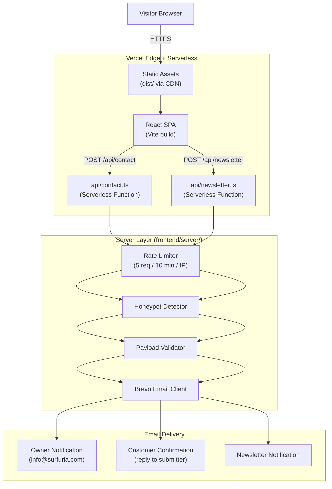

# Surfuria — Architectural Hardware & Modular Kitchens

> **Live Production Site:** [www.surfuria.com](https://www.surfuria.com)

Surfuria is a professionally designed and deployed commercial website for a premium architectural hardware and modular kitchen brand. The site showcases a curated catalogue of furniture hardware (hinges, drawer systems, handles, pullout storage, corner solutions, accessories) and factory-engineered modular kitchen packages, and drives customer enquiries via a secure contact form and WhatsApp integration.

---

## Features

| Feature | Description |
|---|---|
| **Product Catalogue** | 14 hardware products across 6 categories + 10 kitchen suite pages |
| **Kitchen Configurations** | 4 turnkey modular packages (Single Wall, L-Shaped, Island, U-Shaped) with pricing |
| **Context-Aware Enquiry Form** | Pre-populates a product-specific message based on which CTA the visitor clicked |
| **WhatsApp Integration** | Floating button + deep-link with pre-filled message on every product page |
| **Contact API** | Vercel Serverless Function with rate limiting, honeypot spam protection and Brevo transactional email |
| **Newsletter API** | Footer subscription panel with spam protection and owner notification |
| **3D Interactive Globe** | Three.js globe on the About page showing global reach (lazy-loaded) |
| **GSAP + Motion Animations** | Scroll-triggered sections, hero reveals, and micro-interactions |
| **Build-Time Pre-Rendering** | All 38 routes pre-rendered to static HTML at build time for social crawler compatibility |
| **SEO & Structured Data** | Per-route title, description, OG, Twitter Card, and JSON-LD schema via SEOHead component |
| **Security Headers** | X-Content-Type-Options, X-Frame-Options, Referrer-Policy, Permissions-Policy via vercel.json |
| **Legal Pages** | Privacy Policy and Terms & Conditions with multiple URL aliases |
| **Optimised Assets** | Logo 512×512 PNG (352 KB); images on Cloudinary CDN; Three.js in a separate lazy chunk |

---

## Technology Stack

| Layer | Technology | Version |
|---|---|---|
| UI Framework | React | 19.3.1 |
| Build Tool | Vite | 8.3.4 |
| Language | TypeScript | 6.0.3 |
| Routing | React Router DOM | 7.18.4 |
| 3D Graphics | Three.js | 0.186.1 |
| Animation | GSAP + ScrollTrigger | 3.15.0 |
| Animation | Motion for React | 14.6.0 |
| Deployment | Vercel (Serverless Functions) | — |
| Email | Brevo Transactional API | — |
| Image CDN | Cloudinary | — |
| Testing | Vitest | 5.0.5 |
| Type Checking | TypeScript | 6.0.3 |
| Linting | ESLint | — |

---

## Architecture Overview



---

## Project Structure

```
surfuria/
└── frontend/                      ← Application root (all development happens here)
    ├── api/                       ← Vercel Serverless Functions
    │   ├── contact.ts             ← POST /api/contact — enquiry handler
    │   └── newsletter.ts          ← POST /api/newsletter — subscription handler
    ├── server/                    ← Shared server-side modules (used by api/)
    │   ├── brevo/                 ← Brevo HTTP client + sendTransactionalEmail
    │   ├── config/                ← serverConfig.ts (official email, env loading)
    │   ├── email/
    │   │   └── templates/         ← HTML + text email templates (owner, customer, newsletter)
    │   ├── security/              ← rateLimiter, honeypot, sanitize, ipExtractor
    │   └── validation/            ← contactValidation, newsletterValidation
    ├── src/                       ← React application source
    │   ├── app/router.tsx         ← Route definitions (all pages lazy-loaded)
    │   ├── assets/                ← Logo PNG
    │   ├── build/
    │   │   └── prerenderPlugin.ts ← Vite plugin: pre-renders 38 routes at build time
    │   ├── components/
    │   │   ├── catalog/           ← Shared catalogue UI (ProductCard, ProductCarousel, etc.)
    │   │   ├── layout/            ← Navbar (mega menu + mobile drawer), SiteFooter, SiteLayout
    │   │   ├── seo/               ← SEOHead, schemaHelpers (JSON-LD)
    │   │   └── ui/                ← Button, HeroContent, WhatsAppButton
    │   ├── config/
    │   │   ├── social.ts          ← Social platform config (env-driven)
    │   │   └── whatsapp.ts        ← WhatsApp number resolution + URL builder
    │   ├── data/
    │   │   ├── products/          ← hardwareProducts, kitchenProducts, categories, configurations
    │   │   ├── navigation/        ← Navbar data derived from catalogue
    │   │   └── site/              ← footerData, siteConfig
    │   ├── lib/
    │   │   ├── enquiryContext.ts  ← URL param → rich context object
    │   │   └── enquiryMessageGenerator.ts ← Context-aware pre-fill messages
    │   ├── pages/                 ← All page components
    │   │   ├── HomePage/
    │   │   ├── HardwarePage/
    │   │   ├── ProductDetailPage/
    │   │   ├── KitchensPage/
    │   │   ├── KitchenConfigurationDetailPage/
    │   │   ├── AboutPage/
    │   │   ├── ContactPage/
    │   │   ├── PrivacyPolicyPage/
    │   │   ├── TermsPage/
    │   │   └── NotFoundPage/
    │   └── styles/
    │       ├── tokens.css         ← CSS custom properties (colours, typography, spacing)
    │       └── global.css         ← Base reset and global styles
    ├── public/                    ← Static assets served as-is
    │   ├── sitemap.xml            ← 35 canonical URLs
    │   └── robots.txt
    ├── tests/                     ← 9 test suites, 102 tests (Vitest)
    ├── index.html                 ← SPA entry point + base metadata + JSON-LD
    ├── vite.config.ts             ← Vite config with prerenderPlugin and code splitting
    ├── vercel.json                ← Framework: vite, cleanUrls, security headers, cache
    ├── package.json
    ├── tsconfig.json              ← References app, node, and server tsconfig
    └── .env.example               ← Environment variable template
```

---

## Local Development

### Prerequisites

- Node.js 18+ (LTS recommended)
- npm 9+
- A [Brevo](https://www.brevo.com/) account with a transactional API key (only required to test email sending)

### 1. Install Dependencies

```bash
cd frontend
npm install
```

### 2. Configure Environment Variables

```bash
cp .env.example .env.local
```

Open `.env.local` and fill in the values:

```dotenv
# Required for email delivery (contact form and newsletter)
BREVO_API_KEY=xkeysib-your_actual_api_key
BREVO_SENDER_EMAIL=info@yourdomain.com
BREVO_SENDER_NAME=Surfuria
CONTACT_RECIPIENT_EMAIL=info@surfuria.com

# WhatsApp business number (with country code, digits only)
VITE_WHATSAPP_NUMBER=919424602091
WHATSAPP_NUMBER=919424602091

# Social media profile URLs
VITE_SOCIAL_INSTAGRAM_URL=https://instagram.com/surfuria
VITE_SOCIAL_PINTEREST_URL=https://pinterest.com/surfuria
VITE_SOCIAL_LINKEDIN_URL=https://linkedin.com/company/surfuria
VITE_SOCIAL_FACEBOOK_URL=https://facebook.com/surfuria
VITE_SOCIAL_X_URL=https://x.com/surfuria
```

### 3. Run the Development Server

**Frontend only** (no API — contact and newsletter endpoints will not work):
```bash
npm run dev
```

**Full stack with Vercel Serverless Functions** (requires Vercel CLI):
```bash
npm run dev:vercel
# or equivalently:
npx vercel dev
```

The app will be available at `http://localhost:5173` (Vite) or `http://localhost:3000` (Vercel CLI).

---

## Environment Variables Reference

| Variable | Required | Side | Description |
|---|---|---|---|
| `BREVO_API_KEY` | Yes (email) | Server | Brevo transactional email API key. Never prefix with `VITE_`. |
| `BREVO_SENDER_EMAIL` | Yes (email) | Server | Verified sender address in your Brevo account. |
| `BREVO_SENDER_NAME` | No | Server | Display name for outgoing emails. Defaults to `Surfuria`. |
| `CONTACT_RECIPIENT_EMAIL` | No | Server | Inbox that receives owner notifications. Defaults to `info@surfuria.com`. |
| `VITE_WHATSAPP_NUMBER` | No | Client | WhatsApp business number with country code (digits only). Defaults to `919424602091`. |
| `WHATSAPP_NUMBER` | No | Server | Same number for server-side resolution. |
| `VITE_SOCIAL_INSTAGRAM_URL` | No | Client | Instagram profile URL. Leave blank to hide the icon. |
| `VITE_SOCIAL_PINTEREST_URL` | No | Client | Pinterest profile URL. |
| `VITE_SOCIAL_LINKEDIN_URL` | No | Client | LinkedIn company page URL. |
| `VITE_SOCIAL_FACEBOOK_URL` | No | Client | Facebook page URL. |
| `VITE_SOCIAL_X_URL` | No | Client | X (formerly Twitter) profile URL. |

> **Security note:** Variables without the `VITE_` prefix are never bundled into client JavaScript. Keep `BREVO_API_KEY` and `BREVO_SENDER_EMAIL` server-only at all times.

---

## Testing

The test suite runs with [Vitest](https://vitest.dev/) in a Node environment.

```bash
cd frontend
npm test
```

**9 test suites — 102 tests — all passing** (as of 2026-10-31):

| Suite | Tests | Coverage area |
|---|---|---|
| `contactApi.test.ts` | 35 | Contact API validation, rate limiting, honeypot, email building |
| `newsletterApi.test.ts` | 16 | Newsletter API validation, spam protection, email building |
| `enquiryMessageGenerator.test.ts` | 11 | Message generation for all context types |
| `socialConfig.test.ts` | 11 | Social platform config resolution and env fallbacks |
| `sitemap.test.ts` | 7 | Sitemap existence, 35 URL count, canonical format |
| `prerender.test.ts` | 6 | Pre-render plugin route collection |
| `contactInfo.test.ts` | 8 | Official email / phone used consistently across codebase |
| `whatsapp.test.ts` | 4 | WhatsApp number resolution and URL builder |
| `legalRoutes.test.ts` | 4 | Legal page route aliases |

---

## Build

```bash
cd frontend
npm run build
```

The build:
1. Compiles and bundles all TypeScript/TSX with Vite + Rollup.
2. Splits Three.js into a separate `vendor-three` chunk (lazy-loaded only when the About page is visited).
3. Runs `prerenderPlugin`: generates a static HTML file for each of the 38 application routes with baked-in `<title>`, `<meta>`, Open Graph, and JSON-LD tags.
4. Produces `dist/404.html` from the NotFoundPage, which Vercel serves with a real HTTP 404 status.

**Build output (approximate, 2026-10-31):**

| Asset | Size | Gzipped |
|---|---|---|
| `vendor-three-*.js` | 559 KB | 140 KB |
| `index-*.js` (main app) | 349 KB | 113 KB |
| `react-*.js` | 133 KB | 44 KB |
| `gsap-*.js` | 69 KB | 27 KB |
| `products-*.js` | 47 KB | 13 KB |
| `index-*.css` | 41 KB | 8 KB |
| `surfuria logo-*.png` | 352 KB | — |

---

## Deployment

The project is deployed on **Vercel** and configured via [`frontend/vercel.json`](frontend/vercel.json):

- `"framework": "vite"` — Vercel auto-detects build command and output directory.
- `"cleanUrls": true` — `/about` serves from `dist/about/index.html` without a trailing slash.
- Security headers applied to all routes: `X-Content-Type-Options`, `X-Frame-Options`, `Referrer-Policy`, `Permissions-Policy`.
- `/assets/*` served with 1-year immutable cache headers.
- `dist/404.html` is served by Vercel with HTTP 404 for unknown paths.

**No custom server, no Docker, no separate backend deployment is required.** Push to the connected Git branch and Vercel builds and deploys automatically.

---

## Production

| | |
|---|---|
| **Live URL** | https://www.surfuria.com |
| **Hosting** | Vercel |
| **Email** | Brevo transactional (SMTP/API) |
| **Images** | Cloudinary CDN |
| **Sitemap** | https://www.surfuria.com/sitemap.xml |
| **Robots** | https://www.surfuria.com/robots.txt |

---

## Roadmap

- [ ] WebP/AVIF conversion for product images (currently JPEG/PNG on Cloudinary)
- [ ] Real User Monitoring (RUM) / Web Vitals analytics integration
- [ ] Expanded end-to-end tests with Playwright or Cypress
- [ ] Newsletter subscriber management (CRM / Brevo contact list sync)
- [ ] Product availability and pricing CMS integration

---

## Contact

**Email:** info@surfuria.com  
**Phone:** +91 9424602091  
**WhatsApp:** [wa.me/919424602091](https://wa.me/919424602091)

